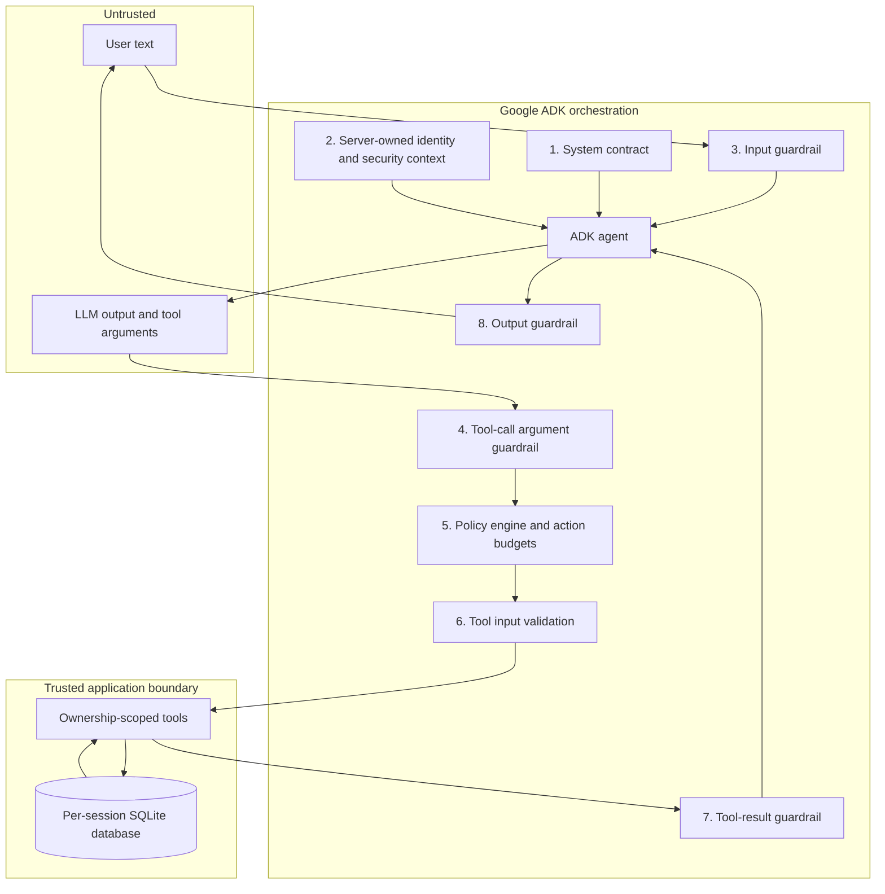
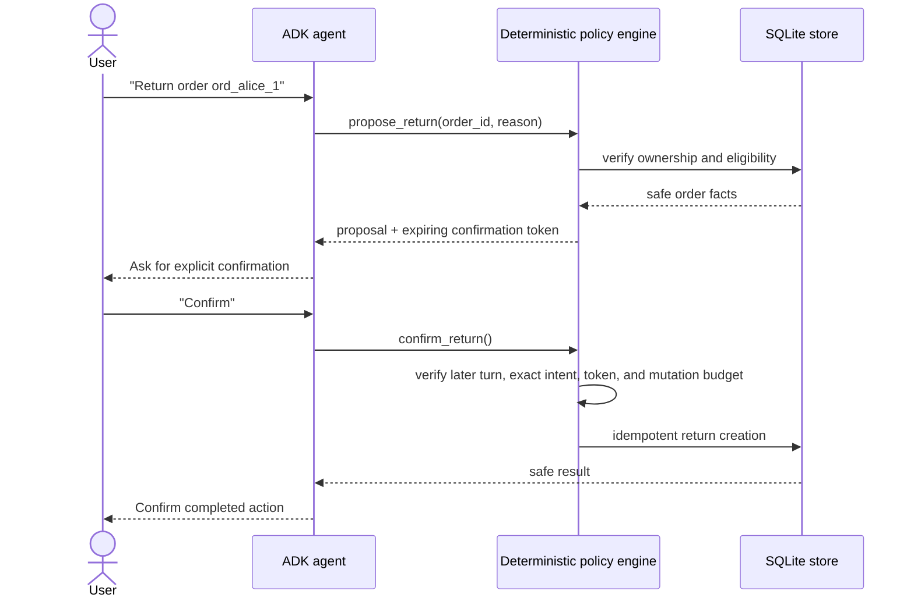

# Secure AI architecture

Secure AI uses defense in depth. Google ADK orchestrates the model and lifecycle callbacks, while application-owned Python code enforces authorization, data access, state transitions, and side effects.

## Trust boundaries

The model never receives authority merely because it produced a valid-looking function call. A server-created `SecurityContext` supplies identity, limits each turn to three tool calls and one mutation, and stores pending confirmation state. Tool methods independently validate schemas, ownership, allowed state transitions, and idempotency before touching the database.

## Consequential-action workflow

## Responsibility split

| Component | Responsibility |
| --- | --- |
| Google ADK | Conversation loop, function-tool wiring, sessions, and lifecycle callback hooks |
| Respan | Gateway model routing, ADK tracing, and adversarial assessment |
| Secure AI guardrails | Input/tool/result/output inspection and fail-closed responses |
| Security context | Server-owned identity, per-turn budgets, and confirmation state |
| Secure tools | Validation, authorization, ownership filtering, and idempotency |
| SQLite store | Isolated fictional commerce data and transactional state |

## Known limits

- The database and ADK session service are intentionally in memory for safe local demos.
- Pattern-based filters supplement—but do not replace—the deterministic authorization boundary.
- The prototype has no end-user authentication layer; the demo identity is server configuration.
- A strong red-team result is evidence for the tested attack set, not proof that the system is unbreakable.
